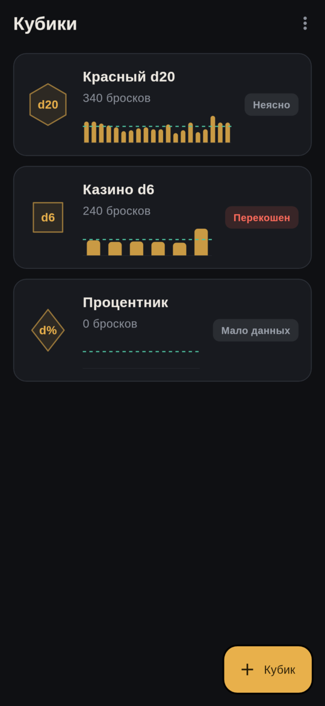
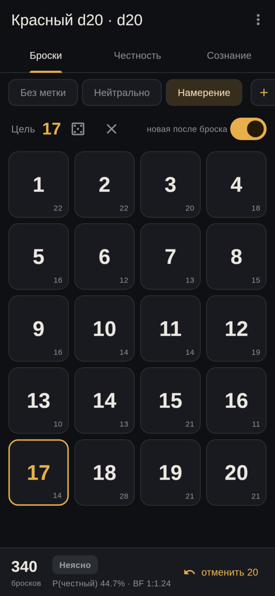
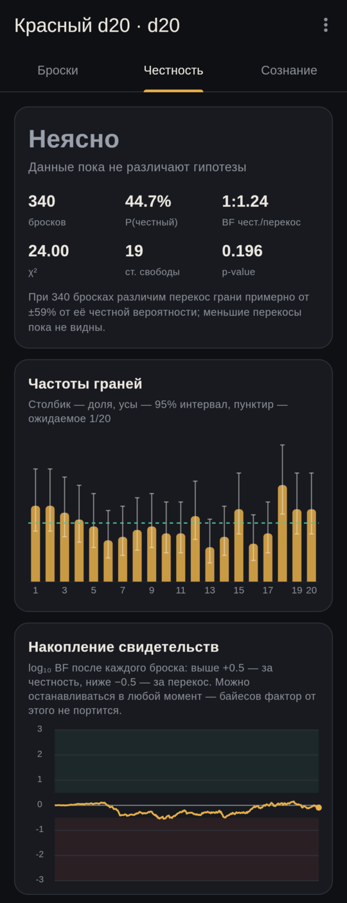
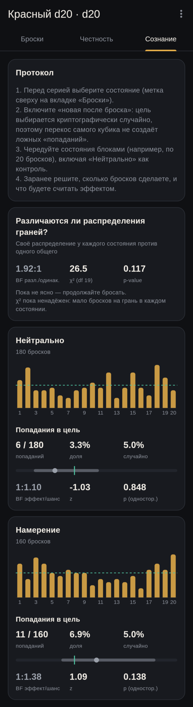

# Dice Checker

**English** · [Русский](README.ru.md)

An Android app for testing whether physical dice (d4, d6, d8, d10, d% and d20)
are fair, and for running controlled experiments on whether a state of mind
affects the outcome of a roll.

You roll a die, tap the face that came up, and the app keeps a running
Bayesian verdict: *fair*, *biased*, *unclear* or *not enough data*. The
interface is in Russian.

<p align="center">
  
  
  
  
</p>

## Usage

1. **Dice** (Кубики): add each physical die separately.
2. **Rolls** (Броски): roll and tap the face that came up. The verdict and
   Bayes factor at the bottom update after every roll. Tap "undo" (отменить)
   to fix a mistake.
3. **Fairness** (Честность): a histogram with 95% intervals, the evidence
   accumulated over time, χ², per-face deviations and an estimate of the
   smallest bias the current number of rolls can detect.
4. **Mind** (Сознание): states (labels) and targets:
   - pick a state in the top row ("Neutral", "Intention" or your own);
   - turn on "new after roll" (новая после броска): before each roll the app
     draws a random target face (`Random.secure`) for you to concentrate on;
   - alternate states in blocks, and use "Neutral" with the same random
     targets as the control.

## How the statistics work

- **Fairness.** A Bayes factor (BF) compares "all faces are equally likely"
  against "face probabilities deviate from 1/k". The alternative is a
  symmetric Dirichlet prior scaled so that a face's probability typically
  differs from 1/k by about ±15%. A flat Dirichlet(1) prior would expect
  unrealistically large biases and so would call almost any die "fair". The
  BF updates after every roll and, unlike a p-value, stays valid if you watch
  it continuously and stop whenever you like. Thresholds:
  |log₁₀ BF| ≥ 0.5 is moderate evidence, ≥ 1 is strong evidence.
- **Pearson's χ²** with its p-value is shown for comparison. It is reliable
  from roughly 5·k rolls, where k is the number of faces.
- **Differences between states.** A BF for "each state has its own face
  distribution" against "all states share one distribution", plus a χ²
  contingency-table test.
- **Hitting the target.** The hit rate is compared against the 1/k chance
  level with a Wilson interval, a BF (Beta prior centred on 1/k with ±50%
  spread) and a one-sided z-test. Targets are drawn at random, so a biased
  die cannot produce a false effect.

How many rolls you need: spotting a bias of about ±30% on one face of a d20
takes hundreds of rolls. Biases of a few percent show up only after
thousands.

## Data

Rolls are stored in a JSON file in the app's private directory (no plugins;
`MainActivity.kt` provides the path). The home screen menu can export CSV,
copy a JSON backup to the clipboard, and restore from one.

## Building

### With Nix (recommended)

```sh
nix run .#build-apk     # → build/app/outputs/flutter-apk/app-arm64-v8a-release.apk
nix run .#install       # build and install on a phone over adb (enable USB debugging)
nix develop             # shell with Flutter, JDK 17 and the Android SDK
flutter test            # statistics tests
```

Flutter, the JDK, the Android SDK and the NDK (required by the Flutter Gradle
plugin) come from nixpkgs (`androidenv`). The first run downloads about
1.5 GB. Gradle caches its own dependencies in `~/.gradle` on the first build,
so the build is not a fully offline, pure Nix derivation.

### Without Nix

Install Flutter (Dart SDK ≥ 3.13), JDK 17 and the Android SDK with platform 36,
build-tools 36.0.0 and NDK 28.2.13676358, then:

```sh
flutter pub get
flutter build apk --release --split-per-abi --target-platform android-arm64
adb install -r build/app/outputs/flutter-apk/app-arm64-v8a-release.apk
```

### Screenshots

The screens can be rendered to PNG without a phone (output goes to
`test_screens/out/`):

```sh
nix develop -c env SCREEN_FONT_DIR=$(nix build --print-out-paths nixpkgs#liberation_ttf)/share/fonts/truetype \
  flutter test test_screens --update-goldens
```

## License

[MIT](LICENSE)
